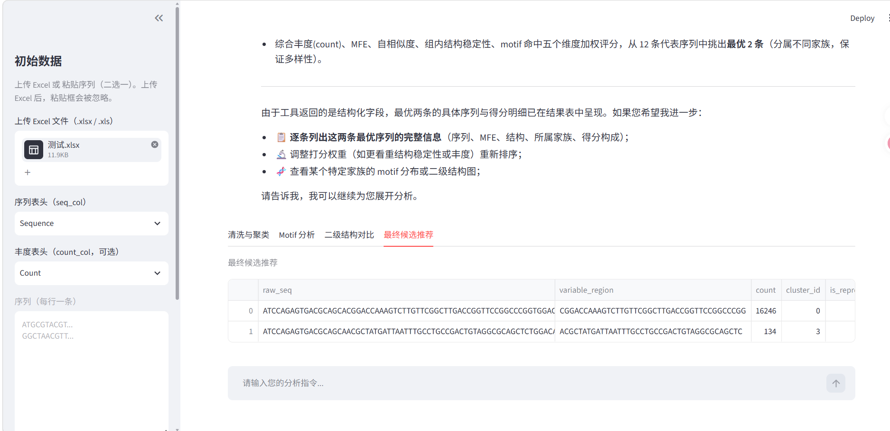
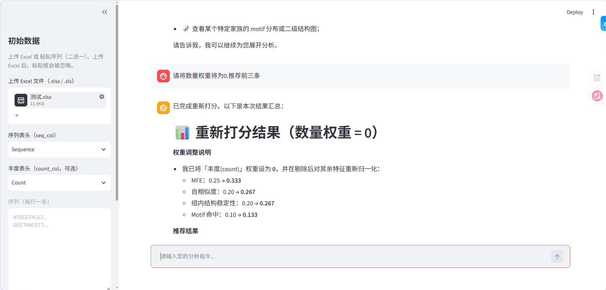
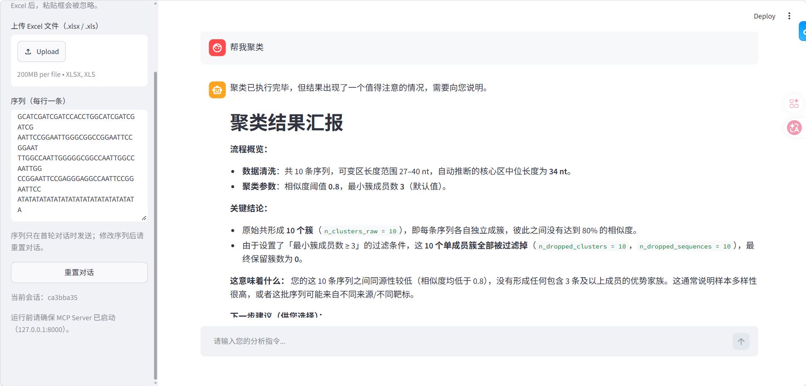
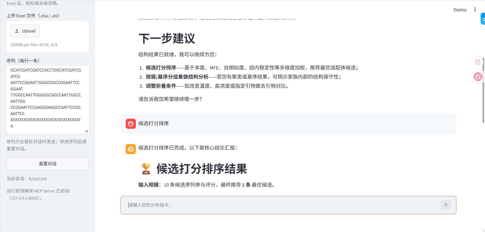

# 🧬 Aptamer-Agent: 智能适配体筛选全栈系统

基于 **LangGraph + MCP 协议 + Streamlit** 构建的 AI 智能体系统，用于自动化适配体的测序数据清洗、同源聚类、Motif 挖掘、二级结构预测与综合打分。

## 🌟 核心特性

- **智能人机协同**：支持自然语言指令，Agent 自动规划分析路径。
- **MCP 微服务架构**：底层生信算法封装为 Model Context Protocol 服务。
- **全链路数据可视**：Streamlit 前端实时展示思考过程与多 Tab 数据看板。
- **全链路可观测性**：内置轻量级结构化日志系统，基于 `contextvars` 自动注入 `trace_id` 与 `node_name`，同时支持彩色控制台输出与 JSON 本地落盘，精准追踪 Agent 与 MCP 交互全过程。
- **防死循环熔断**：自研数据分流与状态隔离机制。

## 🚀 快速开始

> 目标：从零开始把项目跑起来。下面每一步都可以直接复制命令执行。
>
> 你需要准备：Python 3.10+、Docker Desktop（已启动）、一个可用的 LLM API Key。

### 第 0 步：确认环境

打开终端，依次执行：

```bash
python --version
docker --version
docker ps
```

- `python --version` 应显示 **3.10 或更高版本**。
- `docker ps` 能正常输出（哪怕没有容器）说明 Docker 已启动。

> **Windows 用户**：如果输入 `python` 却弹出微软商店，请先从
> [python.org](https://www.python.org/downloads/) 安装 Python 3.10+，安装时勾选
> **Add Python to PATH**，然后重新打开终端。也可以改用 `py -3` 命令。

### 第 1 步：安装项目依赖

进入项目根目录（后续所有命令都在这里执行）：

```bash
cd Aptamer_agent
python -m pip install --upgrade pip
pip install -r requirements.txt
```

> ⚠️ **Windows 用户避坑**：由于 ViennaRNA 包含 C 扩展，Windows 下直接 `pip install` 可能失败。
> 推荐在 WSL2 或 Conda 环境下安装：`conda install -c bioconda viennarna`。
> 如果仍然安装失败，可暂时注释掉 `requirements.txt` 中的 ViennaRNA，系统会自动降级并跳过结构预测。

### 第 2 步：配置 `.env`

先复制一份配置文件。**Windows（CMD）**：

```bat
copy .env.example .env
```

**Windows（PowerShell）/ macOS / Linux**：

```bash
cp .env.example .env
```

用记事本或 VS Code 打开根目录下新生成的 `.env`，至少填写你的 API Key：

```env
LLM_API_KEY=sk-你的真实密钥
```

默认使用 **DeepSeek**，其余两项保持默认即可：

```env
LLM_BASE_URL=https://api.deepseek.com
LLM_MODEL_NAME=deepseek-chat
```

如果使用其他兼容 OpenAI 接口的模型，只需修改这两项，例如：

- OpenAI：`LLM_BASE_URL=https://api.openai.com/v1`、`LLM_MODEL_NAME=gpt-4o`
- 通义千问：`LLM_BASE_URL=https://dashscope.aliyuncs.com/compatible-mode/v1`
- Kimi：`LLM_BASE_URL=https://api.moonshot.cn/v1`
- 本地 Ollama：`LLM_BASE_URL=http://localhost:11434/v1`、`LLM_MODEL_NAME=qwen2.5`

> 旧变量 `DEEPSEEK_API_KEY` 仍可作为 `LLM_API_KEY` 的回退值使用。
> `.env` 含有密钥，请勿提交到 GitHub。

### 第 3 步：拉取 Docker 镜像（Motif 分析必需）

确保 Docker Desktop 已经启动，然后执行：

```bash
docker pull memesuite/memesuite:latest
```

检查镜像是否拉取成功：

```bash
docker images
```

应当能在列表中找到 `memesuite/memesuite`。首次拉取可能需要几分钟，请耐心等待。

#### 🪟 Windows 用户必看：Docker 挂载路径

Motif 分析会把临时文件放到 **`D:\DockerShare`**，再挂载进 Docker 容器。请提前完成：

1. 在 D 盘新建文件夹 `D:\DockerShare`（路径必须是这个）。
2. 打开 **Docker Desktop → Settings → Resources → File sharing**，勾选 **D:**，
   点击 **Apply & restart**，等待 Docker 重启完成。
3. 确认 `.env` 中保持默认配置：

   ```env
   APTAMER_DOCKER_PATH_STYLE=native
   ```

如果 Motif 步骤仍提示挂载失败或路径错误，把该值改为 WSL 风格后重试：

```env
APTAMER_DOCKER_PATH_STYLE=wsl
```

> **建议**：Windows 10/11 优先使用 Docker Desktop 的 **WSL 2 backend**。
> 如果你打算在 WSL 2 里运行本项目，请先在 Docker Desktop →
> Settings → Resources → **WSL Integration** 中启用对应发行版，并在 WSL 终端执行
> `docker ps` 确认 Docker 可用。

### 第 4 步：启动 MCP 工具服务（终端 1）

打开**第一个终端**，进入项目根目录，执行：

```bash
python mcp_server/server.py
```

看到服务成功监听 `127.0.0.1:8000` 的日志后，**保持这个终端不要关闭**。

> 如果 8000 端口已被占用，可修改 `.env`：
>
> ```env
> MCP_SERVER_PORT=8001
> ```
>
> MCP Server 与 Agent 会读取同一份 `.env`，只需改这一处。

### 第 5 步：启动 Web 界面（终端 2）

**不要关闭终端 1**。再打开**第二个终端**，进入项目根目录，执行：

```bash
streamlit run frontend/app_ui.py
```

浏览器通常会自动打开；如果没有，请手动访问：

```text
http://localhost:8501
```

至此，项目已经启动完成，可以在网页中上传 Excel 或粘贴序列开始分析。

### 🧯 常见问题

| 现象                              | 处理方法                                                                                   |
|---------------------------------|----------------------------------------------------------------------------------------|
| 前端提示连不上 MCP Server              | 确认终端 1 仍在运行；确认两边的 `MCP_SERVER_HOST` / `MCP_SERVER_PORT` 一致                             |
| `docker pull` 失败 / 找不到 Docker   | 启动 Docker Desktop，等待状态变为 Running 后重试                                                   |
| Motif 步骤报 mount / permission 错误 | 确认 `D:\DockerShare` 已创建，且 Docker Desktop 已共享 D 盘；必要时设置 `APTAMER_DOCKER_PATH_STYLE=wsl` |
| `python` 打开微软商店                 | 安装 python.org 版本并勾选 Add to PATH，或使用 `py -3`                                            |
| `streamlit` 命令不存在               | 改用 `python -m streamlit run frontend/app_ui.py`                                        |
| 8501 端口被占用                      | 执行 `streamlit run frontend/app_ui.py --server.port 8502`，然后访问 `http://localhost:8502`  |
| LLM 报鉴权失败                       | 检查 `.env` 中的 `LLM_API_KEY`、`LLM_BASE_URL`、`LLM_MODEL_NAME` 是否匹配                        |

## 📸 界面演示









## 📜 协议

MIT License
